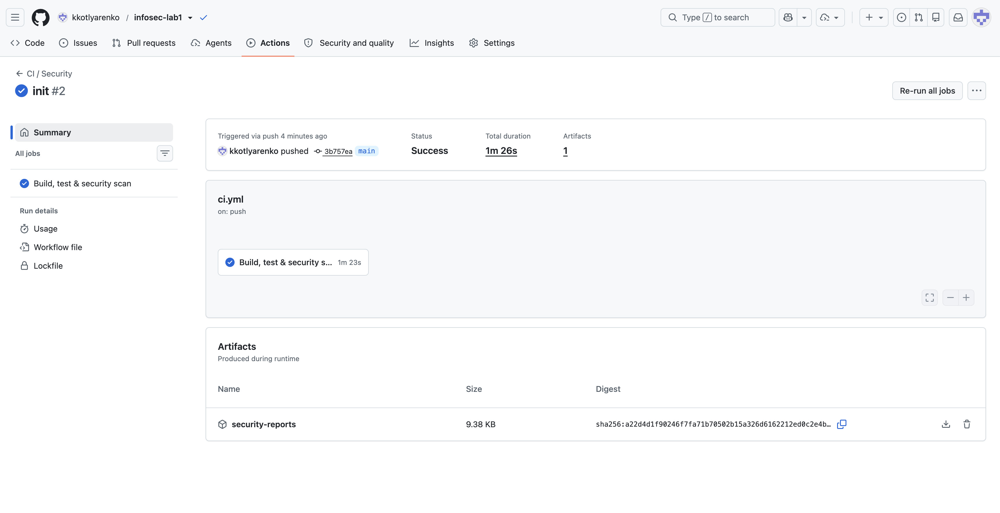
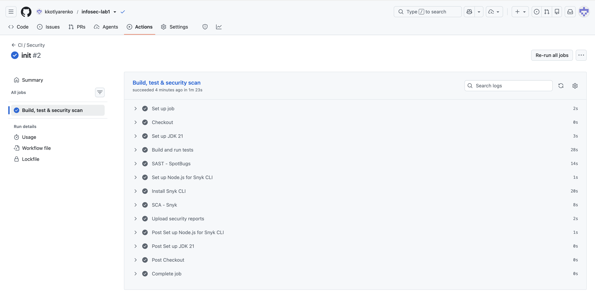

# Microblog API

REST API микроблога на Java/Spring Boot с JWT-аутентификацией, хэшированием паролей и автоматическими проверками безопасности (SAST/SCA) в GitHub Actions.

Стек: Java 21, Spring Boot 4, Spring Security, JJWT (HS256), BCrypt, Spring Data JPA + H2, Maven.

## API

| Метод | Путь | Доступ | Описание |
|---|---|---|---|
| `POST` | `/auth/login` | публичный | Аутентификация по логину и паролю, выдача JWT |
| `GET` | `/api/data` | только с JWT | Список пользователей (без хэшей паролей) |
| `GET` | `/api/posts` | только с JWT | Список постов |
| `POST` | `/api/posts` | только с JWT | Создание поста от имени текущего пользователя |
| `POST` | `/auth/register` | публичный | Регистрация пользователя |
| `GET` | `/api/health` | публичный | Проверка доступности сервиса |

## Меры защиты

### Защита от SQL-инъекций (SQLi)

- Вся работа с БД идёт через Spring Data JPA (Hibernate), который для любого запроса
  формирует параметризованный `PreparedStatement` с bind-параметрами.
- Пользовательский ввод нигде не конкатенируется в текст SQL/JPQL. Даже явный запрос
  `UserRepository.findByUsernameSafe` использует именованный параметр `:username`
  (`@Query("SELECT u FROM User u WHERE u.username = :username")`).
- Динамический SQL и `nativeQuery` в проекте отсутствуют.
- Дополнительно логин валидируется по шаблону `^[A-Za-z0-9_.-]+$`, поэтому полезная
  нагрузка вида `' OR '1'='1` отклоняется ещё на уровне валидации (тест
  `sqlInjectionInLoginDoesNotBypassAuth`).

### Защита от XSS

- Все пользовательские данные, возвращаемые в ответах API, проходят output-encoding
  через `HtmlSanitizer` (`HtmlUtils.htmlEscape`): `<`, `>`, `&`, `"`, `'` заменяются
  на HTML-сущности, поэтому данные не могут быть исполнены как разметка/скрипт.
- Пример: payload `` возвращается как
  `&lt;script&gt;alert(&#39;xss&#39;)&lt;/script&gt;` (тест `userSuppliedDataIsEscapedInResponses`).
- В ответы попадают только неизменяемые DTO (`PostResponse`, `UserResponse`),
  JPA-сущности и хэши паролей не сериализуются.
- Входные данные ограничены по длине и формату (`@Valid`, `@Size`, `@Pattern`).

### Аутентификация и хранение паролей (Broken Authentication)

- Пароли хранятся только в виде BCrypt-хэша со случайной солью (strength 12); открытый
  пароль не сохраняется и не логируется (`AuthService.register`).
- При успешном входе `POST /auth/login` выпускается JWT (HS256) с claims `sub` (логин),
  `role`, `iat`, `exp`; токен подписан секретом сервера и имеет ограниченное время жизни.
- Написан middleware `JwtAuthenticationFilter`, который на каждом запросе проверяет
  заголовок `Authorization: Bearer <token>`, верифицирует подпись и срок действия токена
  и помещает аутентификацию в `SecurityContext`. Невалидный или отсутствующий токен
  даёт `401 Unauthorized`.
- API stateless (сессии отключены), CSRF отключён осознанно — cookie-аутентификации нет.
- При неверных учётных данных возвращается одинаковый ответ `401 invalid username or
  password` — не раскрывается, что именно неверно; stack trace и внутренние детали
  наружу не отдаются.

## CI/CD

Pipeline `.github/workflows/ci.yml` запускается при каждом `push` и `pull_request` и
выполняет:

1. сборку и интеграционные тесты (`mvn clean test`);
2. **SAST** — SpotBugs (`mvn spotbugs:check`);
3. **SCA** — Snyk (`snyk test --all-projects`) с публикацией отчётов в артефакте
   `security-reports`.

Последний успешный прогон: <https://github.com/kkotlyarenko/infosec-lab1/actions/runs/39447287939>

